# Phân tích và triển khai các bài toán trong project

Kiều Trường Giang — B23DCCN254. Tài liệu này giải thích dữ liệu, cơ chế và giới hạn của các chức năng đang triển khai, đi kèm bằng chứng từ `main.ipynb`, CSV dự đoán và checkpoint. Báo cáo học phần đầy đủ nằm trong Word/PDF năm chương; các phần dưới tập trung vào đường đi của từng bài toán lên web.

[Web](https://rag-httm-chatbot.vercel.app/)

[GitHub](https://github.com/jellalaz/HTTM_ThayQue)

## Chạy và tái lập

Chọn Run All trong `main.ipynb`, chế độ full, seed 42. Notebook nhúng mã huấn luyện, phân tích và đóng gói, tự tải dữ liệu công khai khi thiếu. Cache được kiểm tra bằng hash. Lần kiểm chứng full CPU gồm ML, CNN 8 epoch và sáu mạng chuỗi 35 epoch/mạng. Phân tích bổ sung không train lại trọng số, không đổi lựa chọn theo test. Raw dữ liệu được tải lại từ URL/hash trong manifest; không đưa token vào repository.

Các luồng triển khai không được đánh đồng với nhau

| Chức năng | Đầu vào → đầu ra | Đường xử lý |
| --- | --- | --- |
| Giá nhà | 11 thuộc tính → tỷ VND | API /api/predict; task=housing |
| Nhãn nguy cơ tổng hợp | 8 số → High/Moderate/Low | API; task=diabetes_classifier |
| CNN | 784 pixel → chữ số 0–9 | API; task=cnn |
| Chuỗi FPT/vàng | 30 log-return + giá → giá bước tiếp theo | API; task=sequence |
| Hồi quy y tế gốc | 10 biến nghiên cứu → điểm tiến triển | JavaScript trong trình duyệt |
| FPT/vàng gốc | Đặc trưng thị trường → dự báo một bước | JavaScript; cấu hình TL02 |
| Chatbot sức khỏe | Câu hỏi + ngữ cảnh → thông tin có căn cứ | BM25 + KG + state machine trong trình duyệt |

## 1. Hai bài toán Machine Learning

Classifier học từ Diabetes Risk Prediction 50.000 dòng tổng hợp, chia 32.000/8.000/10.000; Random Forest 80 cây, depth 10, class_weight balanced được chọn bằng StratifiedKFold 3 phần. Giá nhà dùng 30.229 tin đăng Vietnam Housing 2024, chia 19.377/4.491/6.361; Log Random Forest 80 cây, depth 14, leaf tối thiểu 3 được chọn bằng GroupKFold 3 phần. Các biến tiền xử lý luôn fit trong train của fold.

Kết quả chọn mô hình và đánh giá giữ riêng

| Bài toán | CV | Test | Checkpoint |
| --- | --- | --- | --- |
| Nguy cơ tổng hợp | macro-F1 0.620253 | Accuracy 0.778800; macro-F1 0.608745 | artifacts_tl03/models/diabetes_classifier.joblib |
| Giá nhà | MAE 1.309074 | MAE 1.276031; R² 0.427331 | artifacts_tl03/models/housing.joblib |

#### 2.2.1. Định nghĩa mẫu, nhãn và đơn vị sử dụng

Ở bài toán phân loại, một mẫu là một dòng dữ liệu và đầu ra là một trong ba nhãn High, Moderate hoặc Low do dataset cung cấp. Chỉ tám biến số được sử dụng nhằm tạo một đầu vào có thể kiểm soát trên giao diện. Việc bỏ các biến chứa điểm nguy cơ hoặc khuyến nghị giúp tránh để mô hình học lại một thông tin đã quá gần nhãn. Đây là lựa chọn chống rò rỉ ở cấp ngữ nghĩa, khác với việc xóa cột vì hệ số tương quan cao.

Từ điển đầu vào classifier và giá trị thiếu thực tế

| Biến | Ý nghĩa / đơn vị | Số thiếu trong 50.000 dòng |
| --- | --- | --- |
| Age | Tuổi | 497 |
| BMI | Chỉ số khối cơ thể | 0 |
| HbA1c | Phần trăm | 1974 |
| Fasting_Blood_Sugar | Đường huyết lúc đói; mg/dL | 0 |
| Blood_Glucose | Glucose; mg/dL | 959 |
| Blood_Pressure_Systolic | Huyết áp tâm thu; mmHg | 0 |
| HDL / LDL | mg/dL | 1.000 ở mỗi biến |

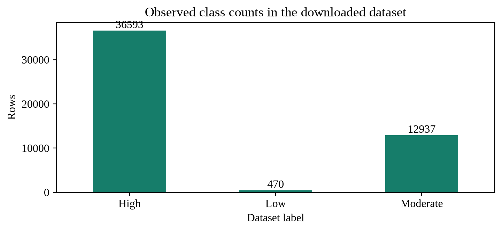

Số lượng ba nhãn đếm trực tiếp từ tệp dữ liệu tải về

Nếu dự đoán mọi mẫu đều là High, Accuracy sẽ gần tỷ lệ của lớp lớn nhất nhưng hệ thống không nhận diện được hai lớp còn lại. Bởi vậy phép so sánh dùng macro-F1, cho mỗi lớp trọng số bằng nhau. class_weight=balanced tăng đóng góp của lớp hiếm trong quá trình học; nó không tự biến điểm số của Random Forest thành xác suất nguy cơ lâm sàng đã được hiệu chỉnh.

#### 2.2.2. Dữ liệu nhà ở và ý nghĩa của phép chia theo địa chỉ

Một mẫu nhà ở là một tin đăng với giá rao bán, không phải biên bản giao dịch. Nhãn Price được giữ ở đơn vị tỷ VND. Các biến diện tích, mặt tiền, đường vào, tầng, phòng và nhóm thông tin pháp lý/nội thất mô tả một phần tài sản; biến Province chỉ lấy thành phần cuối của chuỗi địa chỉ. Cách trích này đơn giản và tái lập được, nhưng chưa phải chuẩn hóa địa giới hay mã hóa tọa độ địa lý.

Nhiều tin có thể cùng địa chỉ. Nếu chia theo dòng, mô hình có thể thấy những bản ghi rất gần nhau trong cả train lẫn test. Project chuẩn hóa địa chỉ bằng chữ thường và bỏ khoảng trắng hai đầu, rồi dùng địa chỉ làm nhóm cho phép chia và GroupKFold. Kiểm tra sau chia cho kết quả 0 nhóm chung ở cả ba cặp train–validation, train–test và validation–test. Điều này giảm một nguồn rò rỉ, nhưng chưa phát hiện được hai cách viết khác nhau của cùng địa chỉ.

Đối chiếu số dòng và số nhóm sau chia dữ liệu nhà ở

| Tập | Số dòng | Số nhóm địa chỉ |
| --- | --- | --- |
| train | 19377 | 6560 |
| validation | 4491 | 1640 |
| test | 6361 | 2051 |

Mặt tiền thiếu khoảng 38,3%, đường vào 44,0%, hướng nhà 70,3% và hướng ban công 82,6%. Điền trung vị cho biến số giữ được mẫu nhưng không khôi phục thông tin thật đã mất. Giá trị Unknown của biến phân loại cũng không đồng nghĩa một đặc điểm có thật của căn nhà. Vì vậy báo cáo xem missingness là giới hạn dữ liệu, không chỉ là một thao tác kỹ thuật trước huấn luyện.

#### 2.2.3. Pipeline và kiểm soát thông tin giữa các tập

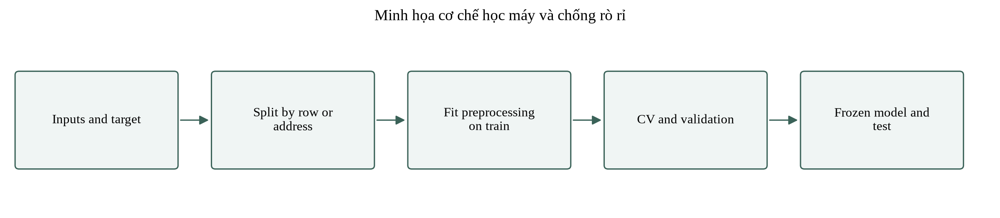

Minh họa quy trình học máy; tiền xử lý chỉ được fit trên train

Trong mỗi fold, imputer tính trung vị từ phần train của fold; bộ chuẩn hóa tính trung bình và độ lệch chuẩn ở cùng phạm vi; one-hot encoder chỉ xây danh sách nhóm từ phần đó. Khi chuyển sang validation của fold, các tham số này được giữ nguyên. Sau khi chọn cấu hình, mô hình cuối được fit trên train, còn validation và test vẫn chỉ đi qua transform và predict. Việc đóng gói các bước trong Pipeline giúp quy tắc này được thực thi thống nhất thay vì phụ thuộc thao tác thủ công.

Random Forest không bắt buộc chuẩn hóa thang đo số, nhưng pipeline nhà ở vẫn chuẩn hóa để các ứng viên Ridge và mô hình cây dùng cùng định nghĩa tiền xử lý. log1p làm giảm mức chi phối của giá lớn trong quá trình học; expm1 đưa dự đoán về tỷ VND trước đánh giá. Tối ưu sai số trên thang log không đồng nghĩa tối ưu MAE trên thang giá, nên bước so sánh CV vẫn tính theo đơn vị gốc.

#### 2.4.1. Hiệu năng từng lớp và tác động của mất cân bằng

Chỉ số từng lớp tính lại từ diabetes_predictions.csv

| Lớp | Precision | Recall | F1 | Mẫu test |
| --- | --- | --- | --- | --- |
| High | 0.9331 | 0.7849 | 0.8526 | 7319 |
| Low | 0.2257 | 0.6170 | 0.3305 | 94 |
| Moderate | 0.5535 | 0.7673 | 0.6431 | 2587 |

Lớp Low chỉ có 94 mẫu test. Recall 0,6170 nghĩa là mô hình tìm được khoảng 61,7% số mẫu Low thực tế, trong khi precision 0,2257 cho thấy nhiều dự đoán Low là nhầm từ lớp khác. Với High, precision 0,9331 cao hơn nhưng recall chỉ 0,7849. Nhìn riêng Accuracy 0,7788 sẽ che bớt sự khác nhau này. Kết quả phù hợp với tác động của cân bằng trọng số: tăng khả năng nhận diện lớp ít mẫu nhưng có thể tăng số dương tính giả theo cách xét từng lớp.

Chưa có tập bệnh nhân bên ngoài, nhãn lâm sàng độc lập hoặc đánh giá hiệu chỉnh xác suất. Do đó giao diện chỉ hiển thị nhãn dataset và giải thích phạm vi, không chuyển High thành chẩn đoán mắc bệnh, không đưa phần trăm nguy cơ cá nhân và không gắn khuyến nghị điều trị với đầu ra. Hướng cải tiến có cơ sở là xây dữ liệu xác minh và kiểm tra khả năng chuyển miền trước khi tăng số cây hoặc thêm một mạng sâu.

#### 2.4.2. Sai số nhà ở theo phân khúc và phần dư

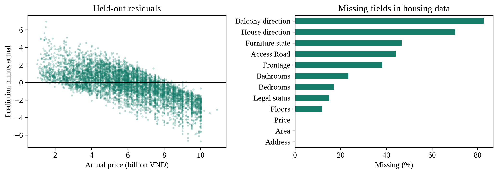

Phần dư test và tỷ lệ thiếu của dữ liệu nhà ở

Phân tích test theo bốn nhóm lượng tử của giá thực

| Khoảng giá thực (tỷ) | Mẫu | MAE (tỷ) | Lệch TB (tỷ) |
| --- | --- | --- | --- |
| (0.999, 4.3] | 1607 | 1.197 | +0.988 |
| (4.3, 5.95] | 1594 | 0.995 | +0.420 |
| (5.95, 7.56] | 1570 | 0.967 | -0.470 |
| (7.56, 10.9] | 1590 | 1.943 | -1.932 |

Phần dư được định nghĩa bằng dự đoán trừ giá thực. Nhóm giá thấp có lệch trung bình dương, còn nhóm trên 7,56 tỷ có lệch khoảng −1,932 tỷ và MAE khoảng 1,943 tỷ. Mẫu hình này cho thấy dự đoán có xu hướng co về vùng trung tâm: nhà rẻ bị định giá cao, nhà đắt bị định giá thấp. Đây là mô tả từ test đã khóa, không phải căn cứ để sửa dự đoán theo chính giá thực của từng mẫu.

Trung vị sai số tuyệt đối là 1.038 tỷ VND; phân vị 90% là 2.688 tỷ VND. Hai đại lượng mô tả phân phối lỗi của tập test, không phải khoảng dự báo 90% cho một căn nhà mới. Để có khoảng dự báo cá nhân cần một quy trình hiệu chỉnh riêng và kiểm tra độ bao phủ ngoài mẫu.

#### 2.4.3. Hai tình huống sử dụng trên web

Với giá nhà, người dùng nhập sáu biến số và chọn năm nhóm thuộc tính. Giá trị số trống được điền bằng trung vị train và API trả cảnh báo; nhóm chưa gặp được mã hóa thành vector 0 của nhóm tương ứng và cũng được cảnh báo. Phiên bản hoàn thiện dùng nhóm phổ biến nhất của train làm mặc định thay vì mục đầu danh sách chữ cái. Các giá trị mặc định tạo một kịch bản nhập liệu, không được giới thiệu là một tài sản quan sát thực tế.

Sau khi nhấn Chạy mô hình, API kiểm tra kiểu và tính hữu hạn, biến đổi đặc trưng bằng tham số train, chạy các cây đã xuất và trả giá theo tỷ VND. Một giá trị vượt min–max train không bị tự cắt về biên; hệ thống giữ đầu vào và đánh dấu ngoài phạm vi. Kết quả phù hợp để quan sát mô hình và đối chiếu kịch bản, chưa đủ cho quyết định mua bán.

[Demo](https://rag-httm-chatbot.vercel.app/?demo=housing#experiments)

Với classifier, giao diện yêu cầu đúng đơn vị đã ghi trong từ điển đầu vào. Giá trị thiếu được xử lý giống quy trình train; sai kiểu, số không hữu hạn hoặc giá trị không dương bị từ chối. Điểm theo lớp của rừng cây là kết quả tổng hợp của mô hình trên nhãn tổng hợp. Vì chưa hiệu chỉnh và chưa xác minh lâm sàng, phần hiển thị ưu tiên nhãn cùng cảnh báo thay vì đặt tên điểm số là xác suất mắc bệnh.

[Demo](https://rag-httm-chatbot.vercel.app/?demo=diabetes_classifier#experiments)

## 2. CNN nhận dạng chữ số

MNIST giữ 10.000 ảnh test chính thức, chia 60.000 ảnh train gốc thành 48.000 train và 12.000 validation. Pixel chia 255; chỉ train dịch ảnh ±1 pixel. CNN 52.138 tham số train từ đầu bằng Adam 0,001, weight decay 0,0001, batch 128, clip norm 1, tám epoch. Checkpoint chọn validation loss thấp nhất tại epoch 8; Accuracy test 0,9866, macro-F1 0,986487. Không dùng pretrained.

#### 3.2.1. Theo dõi một phép tích chập từ ảnh và trọng số thật

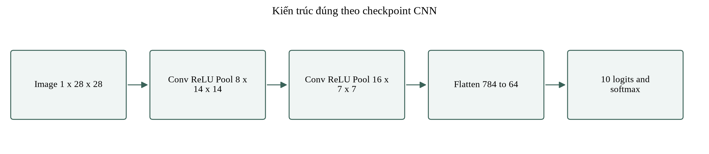

Luồng tensor đúng với kiến trúc trong checkpoint

Mỗi kernel 3 × 3 được trượt qua ảnh và dùng lại cùng chín trọng số tại mọi vị trí. Trong cài đặt Conv2d, phép toán là tương quan chéo: kernel không bị đảo chiều như một số định nghĩa tích chập toán học. Padding 1 giữ chiều cao và chiều rộng; ReLU đặt giá trị âm về 0; max-pooling 2 × 2 chọn cực đại trên các ô không chồng lấn và giảm mỗi chiều xuống một nửa.

![Patch MNIST test[0], kernel Conv1 kênh 0 và tích từng phần tử](artifacts_tl03/figures/cnn_convolution_actual.png)

Patch MNIST test[0], kernel Conv1 kênh 0 và tích từng phần tử

Hình trên lấy ảnh đầu tiên của test, nhãn thật 7; chọn vị trí kích hoạt lớn nhất của kênh 0 theo một quy tắc cố định. Với chỉ số bắt đầu từ 0, hàng 9, cột 19, tổng chín tích cộng bias 0.096586 bằng 2.246353. Kết quả ReLU đọc trực tiếp từ PyTorch là 2.246353. Sai khác nhỏ chỉ do phép tính số thực, được assert nhỏ hơn 10⁻⁵ trong mã phân tích.

Ví dụ này không dùng một ma trận số đặt sẵn để minh họa. Patch lấy từ tệp IDX, kernel và bias lấy từ checkpoint, ảnh tích từng phần tử được tạo bởi code. Do đó có thể lần ngược mỗi con số về đầu vào và tham số đã học. Tuy nhiên, một activation lớn không tự chứng minh kênh đó biểu diễn một khái niệm có tên như “nét chéo”; đó chỉ là phản ứng số của kernel trên ảnh đang xét.

#### 3.2.2. Feature map, receptive field và số tham số

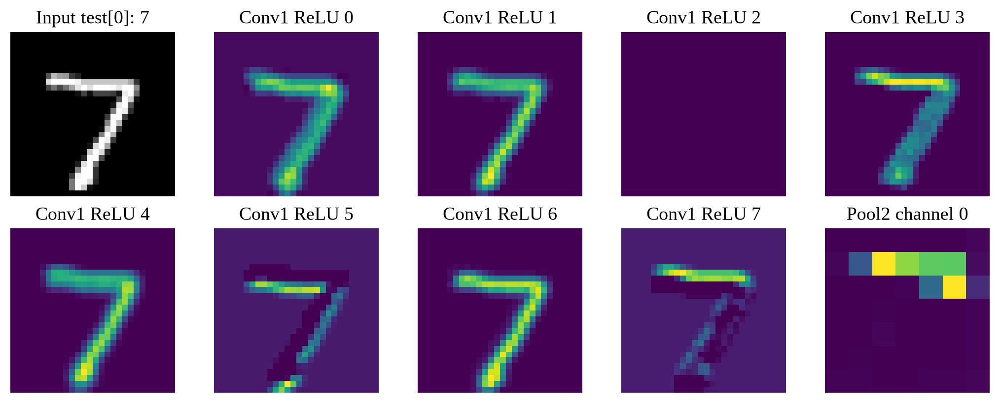

Tám feature map sau ReLU tầng 1 và một kênh sau Pool2 của cùng ảnh

Các feature map cho thấy cùng một ảnh tạo những mức phản ứng khác nhau ở tám kênh. Mỗi kênh được chuẩn màu riêng khi vẽ nên không nên so độ sáng tuyệt đối giữa hai ô ảnh như cùng một thang đo. Mục đích là quan sát vị trí và hình dạng phản ứng; đánh giá độ quan trọng của kênh cần một thí nghiệm riêng như ablation, chưa được thực hiện ở đây.

Theo chuỗi Conv3–Pool2–Conv3–Pool2 với stride của convolution bằng 1, vùng tiếp nhận của một phần tử ở đầu ra Pool2 là 10 × 10 pixel và bước nhảy tương ứng trên ảnh gốc là 4 pixel. Con số này được suy từ kích thước kernel và stride, không phải kích thước một đối tượng mà mô hình chắc chắn nhận biết. Sau Flatten, tầng dense kết hợp toàn bộ 16 × 7 × 7 = 784 giá trị nên đầu ra phân loại sử dụng thông tin toàn ảnh.

Phân rã 52.138 tham số của mạng

| Khối | Cách tính | Tham số |
| --- | --- | --- |
| Conv1 | 8 × (1 × 3 × 3 + 1) | 80 |
| Conv2 | 16 × (8 × 3 × 3 + 1) | 1168 |
| Dense1 | 784 × 64 + 64 | 50240 |
| Dense2 | 64 × 10 + 10 | 650 |

Phần lớn tham số nằm ở Dense1, không phải hai tầng tích chập. Điều này giải thích vì sao tăng kích thước ảnh hoặc số kênh có thể làm mô hình nặng lên nhanh nếu vẫn Flatten trực tiếp. Với MNIST, kiến trúc nhỏ giúp huấn luyện CPU và xuất API nhẹ; không có BatchNorm hay Dropout trong checkpoint dù hai tầng này đã được giới thiệu như các lựa chọn CNN phổ biến ở phần lý thuyết.

#### 3.3.1. Đọc đường học và đánh giá theo từng chữ số

Loss train được đo trong chế độ train có dịch ảnh ngẫu nhiên, còn validation dùng ảnh nguyên và không cập nhật trọng số. Vì điều kiện đầu vào khác nhau, loss train không bắt buộc phải thấp hơn validation ở mọi epoch. Checkpoint epoch 8 được chọn bằng validation loss trong số tám epoch đã định; không phải bằng kết quả tốt nhất trên test và cũng chưa chứng minh rằng huấn luyện lâu hơn sẽ luôn tốt hơn.

Chỉ số từng chữ số tính từ toàn bộ 10.000 dự đoán test

| Chữ số | Precision | Recall | F1 | Mẫu test |
| --- | --- | --- | --- | --- |
| 0 | 0.9839 | 0.9980 | 0.9909 | 980 |
| 1 | 0.9938 | 0.9965 | 0.9952 | 1135 |
| 2 | 0.9961 | 0.9826 | 0.9893 | 1032 |
| 3 | 0.9765 | 0.9861 | 0.9813 | 1010 |
| 4 | 0.9939 | 0.9888 | 0.9913 | 982 |
| 5 | 0.9736 | 0.9933 | 0.9834 | 892 |
| 6 | 0.9947 | 0.9885 | 0.9916 | 958 |
| 7 | 0.9697 | 0.9961 | 0.9827 | 1028 |
| 8 | 0.9876 | 0.9836 | 0.9856 | 974 |
| 9 | 0.9959 | 0.9524 | 0.9737 | 1009 |

Chữ số 9 có recall khoảng 0,9524, thấp hơn các lớp còn lại trong lần chạy này. Chữ số 7 có recall cao nhưng precision khoảng 0,9697, nghĩa là một phần ảnh thuộc lớp khác bị nhận thành 7. Ma trận nhầm lẫn và các ảnh sai giúp đặt giả thuyết về nét chữ gần nhau; chưa có nhãn nguyên nhân lỗi, vì vậy không quy toàn bộ lỗi cho một đặc điểm nét viết cụ thể.

#### 3.3.2. Confidence không thay thế kiểm tra độ đúng

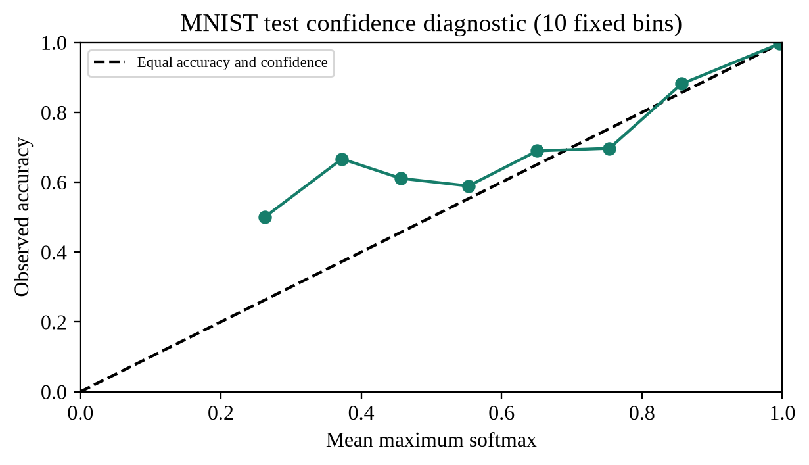

Độ đúng quan sát và confidence trung bình trên các khoảng cố định

Confidence ở đây là softmax lớn nhất. Chia test thành 10 khoảng rộng 0,1 cho ECE mô tả khoảng 0.00243; ECE nhỏ trên tập này không bảo đảm mô hình nhận được ảnh ngoài phân phối. Có 5 ảnh nhận sai dù confidence ít nhất 99%. Các khoảng confidence thấp có ít mẫu nên đường biểu diễn dao động mạnh và không nên diễn giải như một ước lượng ổn định.

Không dùng biểu đồ test này để chọn một ngưỡng từ chối rồi báo lại chính test như đánh giá độc lập. Nếu muốn bổ sung cơ chế abstention, cần chọn ngưỡng trên validation hoặc một tập hiệu chỉnh riêng, sau đó kiểm tra cả tỷ lệ bao phủ và sai số trên phần được chấp nhận. Đây là hướng phát triển, chưa phải chức năng có hiệu năng được xác minh trong bản hiện tại.

#### 3.3.3. Đường đi của ảnh trên giao diện

Ảnh test mẫu được đưa trực tiếp vào API ở dạng 784 pixel; ảnh canvas được thu từ 280 × 280 xuống 28 × 28 rồi chia 255 giống miền giá trị train. Bản hiện tại chưa tự căn giữa theo trọng tâm hoặc hiệu chỉnh độ dày nét. Vì vậy hướng dẫn yêu cầu một chữ số sáng ở giữa nền đen. Việc công bố đúng bước xử lý có ý nghĩa hơn việc gán Accuracy MNIST cho mọi ảnh người dùng có thể vẽ.

API đã bổ sung kiểm tra ảnh toàn 0 ở phía máy chủ, ngoài kiểm tra tại giao diện. Nhờ đó gửi yêu cầu trực tiếp không còn nhận một nhãn tưởng như hợp lệ cho ảnh trống. Các lỗi thiếu pixel, pixel ngoài 0–255 hoặc NaN cũng bị từ chối. Thay đổi này cải thiện tính đúng đắn của dịch vụ; không được tính là tăng Accuracy của checkpoint vì trọng số không thay đổi.

[Demo](https://rag-httm-chatbot.vercel.app/?demo=cnn#experiments)

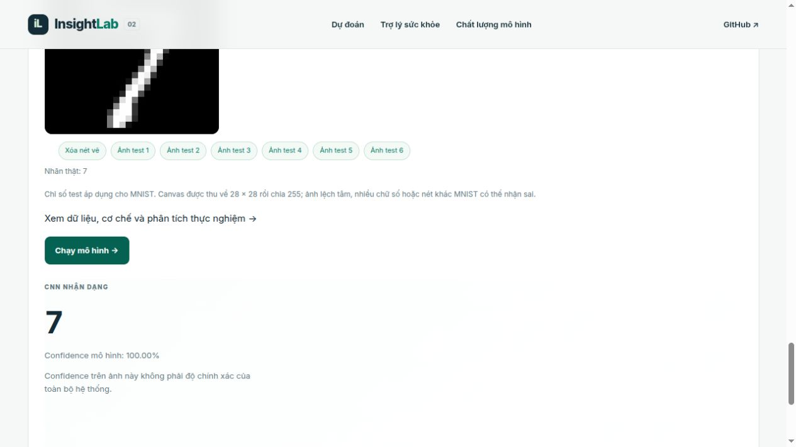

Ảnh chụp production: ảnh test nhãn 7 được API nhận dạng thành 7

## 3. RNN/LSTM/GRU dự báo FPT và vàng

Snapshot FPT.VN và GC=F từ 15/10/2021 đến 14/10/2026. Mỗi mạng có một recurrent layer, hidden 16 và head tuyến tính; train 35 epoch, batch 128, Adam 0,001, clip norm 1. Scaling chỉ fit train. Chọn checkpoint bằng validation MSE; chọn kiến trúc web bằng validation MAE với Persistence cùng tham gia. FPT chọn GRU, vàng chọn Persistence. Các ngày test là ngày nhãn, không phải ngày đặc trưng của pipeline TL02.

GRU inference dùng đúng quy ước PyTorch: reset gate nhân sau phép biến đổi tuyến tính của hidden state trong nhánh ứng viên; update gate z đặt trọng số lên hidden cũ, h=(1−z)·n+z·h_cũ. Một số cách trình bày lý thuyết đặt reset trước ma trận và dùng z cho ứng viên. Không trộn hai quy ước khi xuất checkpoint; bộ test so sánh cả sáu mạng kiểm tra điều này bằng đầu ra số thực.

Đơn vị VND đối với FPT và USD/oz đối với GC=F

| Miền/mạng | Val MAE | Test MAE | Test RMSE |
| --- | --- | --- | --- |
| FPT/RNN | 1270.880 | 720.604 | 1032.599 |
| FPT/LSTM | 1271.182 | 745.759 | 1050.320 |
| FPT/GRU | 1265.027 | 737.054 | 1044.655 |
| Gold/RNN | 63.676 | 47.342 | 61.988 |
| Gold/LSTM | 63.707 | 48.168 | 63.044 |
| Gold/GRU | 63.622 | 48.097 | 62.834 |

#### 4.2.1. Từ giá quan sát đến một mẫu dự báo cụ thể

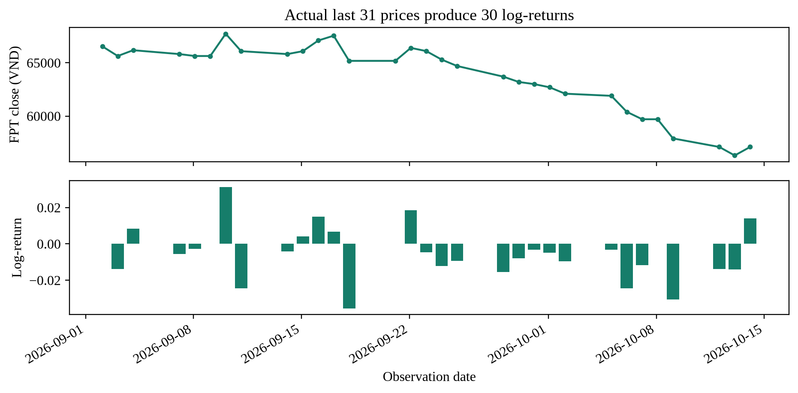

31 giá FPT cuối snapshot và 30 log-return được tính từ chúng

Cửa sổ minh họa lấy từ 2026-09-02 đến 2026-10-14, gồm 31 giá đóng cửa để tạo 30 log-return. Hai giá cuối là 56,300 và 57,100 VND, tạo log-return cuối 0.01410958. Đây chính là một phần đầu vào mặc định của demo, không phải một chuỗi được đặt số để làm đẹp hình. Snapshot dừng ở 14/10/2026; dự báo tiếp theo sau cửa sổ không được gọi là giá đã xác minh của ngày hiện tại.

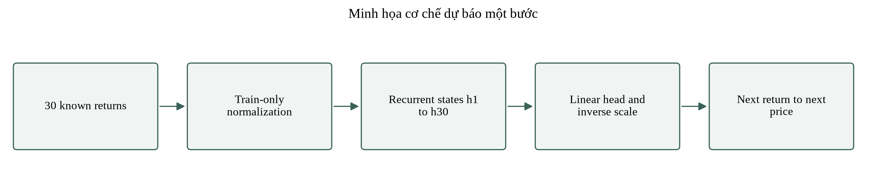

Minh họa cơ chế many-to-one và biến đổi ngược về giá

Mạng nhận tensor [batch, 30, 1], không nhận trực tiếp lịch ngày hoặc mức giá tuyệt đối. Đầu vào là log-return được chuẩn hóa bằng trung bình và độ lệch chuẩn train. Trạng thái ở bước cuối đi qua Linear(16,1), sau đó đầu ra được đưa về thang log-return bằng tham số nhãn train. Cuối cùng nhân giá gần nhất với exp của log-return dự đoán để ra mức giá một bước tiếp theo.

Chọn log-return giảm sự phụ thuộc trực tiếp vào mức giá và giữ giá dự đoán dương sau biến đổi ngược. Tuy vậy phân phối lợi suất vẫn có thể thay đổi theo chế độ thị trường, và mẫu 30 bước không chứa đầy đủ tin tức hoặc điều kiện vĩ mô. Hai chuỗi dùng checkpoint riêng; không chuyển trọng số FPT sang vàng hoặc chuẩn hóa chung bằng dữ liệu của cả hai miền.

#### 4.2.2. Vai trò của trạng thái và cổng trong thực nghiệm

Vanilla RNN cập nhật cùng một trạng thái ẩn qua 30 bước; mọi thông tin cần dùng phải được nén vào vector đó. LSTM có trạng thái ô nhớ và các cổng để điều tiết lượng thông tin cũ giữ lại, lượng ứng viên được ghi vào và phần được phát ra. GRU kết hợp cơ chế cập nhật và reset trong một trạng thái. Những cấu trúc này mở ra đường truyền khác cho thông tin và gradient, nhưng việc cổng có giúp bài toán cụ thể hay không vẫn phải kiểm tra bằng thực nghiệm.

Các mạng dùng cùng độ rộng 16, cùng optimizer, số epoch và quy tắc checkpoint để giảm khác biệt không cần thiết. Số tham số vẫn không bằng nhau vì LSTM và GRU có nhiều nhánh cổng. Đây là so sánh trong một cấu hình kiểm soát, chưa phải tìm kiếm tối ưu công bằng theo cùng số phép tính hoặc cùng số tham số. Không kết luận một họ mạng nói chung kém hơn chỉ từ cấu hình duy nhất này.

#### 4.3.1. Đường học và tính nhất quán của quy tắc lựa chọn

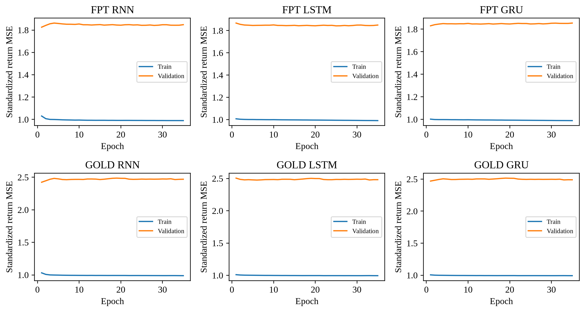

Train/validation MSE của sáu mạng trên nhãn log-return đã chuẩn hóa

Đường học được lưu ở từng epoch, không nội suy thành kết quả chưa chạy. Loss trong hình là MSE của nhãn chuẩn hóa; MAE trong bảng kết quả là sai số sau khi đổi về đơn vị giá. Hai thước đo không xếp hạng mô hình giống nhau trong mọi tình huống. Bởi vậy checkpoint được chọn theo validation MSE trong từng lần train, còn lựa chọn kiến trúc phục vụ web dùng validation MAE theo đơn vị gốc, với quy tắc được giữ trước khi xem test.

Mạng có thể học một lợi suất gần 0 và tạo đường giá trông rất sát quan sát vì mỗi dự báo được neo ở giá của phiên trước. Persistence cũng có lợi suất dự đoán bằng 0 mà không học tham số. Do đó biểu đồ bám giá chỉ hỗ trợ quan sát giai đoạn sai lệch; kết luận về độ hữu ích phải dựa trên phần chênh sai số so với baseline trên cùng ngày nhãn.

#### 4.3.2. Chênh lệch so với baseline và độ bất định theo khối

$$
\Delta_{\mathrm{MAE}}=100\frac{\mathrm{MAE}_{\mathrm{Persistence}}-\mathrm{MAE}_{\mathrm{model}}}{\mathrm{MAE}_{\mathrm{Persistence}}}
$$

Giá trị dương của Δ thể hiện giảm MAE so với Persistence. Phân tích bổ sung lấy mẫu lại các cặp sai số cùng ngày bằng circular block bootstrap, khối dài 5 quan sát, 2.000 lần và seed 42. Mỗi lần dùng cùng chỉ số cho mô hình và baseline để giữ tính ghép cặp; lấy theo khối nhằm bảo toàn một phần phụ thuộc thời gian ngắn. Phân vị 2,5% và 97,5% tạo khoảng mô tả 95%.

Chẩn đoán test so với Persistence; không dùng để đổi lựa chọn web

| Miền / mạng | Giảm MAE (%) | Khoảng bootstrap 95% |
| --- | --- | --- |
| fpt / RNN | +1.860 | [-1.252; +5.105] |
| fpt / LSTM | -1.566 | [-3.272; -0.110] |
| fpt / GRU | -0.381 | [-1.087; +0.266] |
| gold / RNN | +1.553 | [+0.291; +2.732] |
| gold / LSTM | -0.164 | [-1.676; +1.368] |
| gold / GRU | -0.017 | [-0.976; +0.926] |

FPT/RNN có mức giảm điểm khoảng 1,86% nhưng khoảng bootstrap cắt 0; FPT/GRU gần baseline và cũng có khoảng cắt 0. Gold/RNN có khoảng dương trong thiết lập khối đã dùng, song đây là phân tích sau đánh giá, trên một snapshot và chưa điều chỉnh cho nhiều so sánh. Không suy rộng thành bảo đảm vượt baseline ở thị trường tương lai. LSTM FPT kém baseline trong khoảng mô tả này cũng không chứng minh mọi LSTM đều không phù hợp.

Độ dài khối 5 là lựa chọn phân tích cố định, chưa có nghiên cứu độ nhạy với khối khác hoặc nhiều seed train. Khoảng trên phản ánh biến thiên khi lấy mẫu lại các lỗi đã có, không bao gồm toàn bộ bất định do huấn luyện, thay đổi thị trường hay sai số dữ liệu. Vì vậy nó bổ sung cho điểm MAE chứ không thay thế walk-forward backtest.

#### 4.3.3. Hai demo chuỗi và cách đọc kết quả

Demo FPT nhận giá gần nhất theo VND và 30 log-return từ cũ đến mới. Mô hình được cố định là GRU do lựa chọn validation; không thay thành RNN chỉ vì RNN có test tốt hơn trong lần chạy này. Người dùng có thể thay một hoặc nhiều lợi suất để xem độ nhạy của mô hình. Đó là phân tích kịch bản đầu vào, không phải một phép backtest mới và không có kết quả thực tế để tính sai số ngay trên giao diện.

[Demo](https://rag-httm-chatbot.vercel.app/?demo=sequence#experiments)

Demo vàng chọn GC=F và trả đơn vị USD/oz. Validation chọn Persistence nên dự báo bằng giá gần nhất dù 30 log-return vẫn có trong form chung. Giao diện công bố rõ lựa chọn này thay vì gọi một mạng sâu rồi âm thầm bỏ qua dự đoán của nó. Liên kết dưới mở đúng miền vàng. Cả hai demo đều báo ngày snapshot và không gọi API thị trường trực tiếp để tự làm mới giá.

[Demo](https://rag-httm-chatbot.vercel.app/?demo=sequence&domain=gold#experiments)

Bộ phân tích đầu vào được sửa để không chuyển một phần tử trống giữa hai dấu phẩy thành số 0. Máy chủ vẫn yêu cầu đúng 30 số hữu hạn trong [−1,1] và giá gần nhất dương. Các giới hạn này kiểm tra cấu trúc yêu cầu, không chứng minh kịch bản nằm trong phân phối train. Không dùng giá trị đầu ra để suy ra lợi nhuận, tín hiệu mua bán hoặc mức rủi ro đầu tư cá nhân.

## 4. Ba miền dự đoán gốc: dữ liệu và cách phân tích

### Hồi quy tiến triển bệnh

Bộ diabetes có 442 người đã mắc bệnh, 10 biến đầu vào nghiên cứu và nhãn định lượng tiến triển sau một năm. Train/calibration/test là 282/71/89. Ridge được chọn theo CV MAE 44,442606; test MAE 42,936402, RMSE 53,861835, R² 0,452432. Baseline trung vị có MAE 62,275281 trên cùng test. Sai số được tính trên thang điểm nghiên cứu, không phải mg/dL, HbA1c hoặc phần trăm mắc bệnh.

Chuẩn hóa dùng thống kê train. Calibration 71 mẫu tạo bán kính sai số danh nghĩa 90%, khoảng 85,446193 điểm. Coverage quan sát test là 0,865169, không đạt đúng 90% trong mẫu hữu hạn. Khoảng rộng phản ánh giới hạn dự đoán cá nhân. Form phân biệt bp là huyết áp trung bình với cặp tâm thu/tâm trương; s5 là đặc trưng nghiên cứu, không tự đổi thành xét nghiệm triglyceride. Trung vị điền thiếu chỉ phục vụ mô hình, không được chuyển thành số đo đã quan sát của người dùng trong chatbot.

### FPT và vàng của pipeline gốc

Lịch sử giá được sắp theo thời gian, tạo đặc trưng từ các quan sát đã có như lợi suất, trung bình động, RSI và biến động; nhãn là giá của bước tiếp theo. Phép chia calibration/test theo thời gian và TimeSeriesSplit trong train tránh dùng tương lai để chọn cấu hình. FPT chọn Persistence với CV MAE 1.215,9737 VND và test MAE 728,1284 VND; GC=F chọn SVR return với CV MAE 38,7920 USD/oz và test MAE 49,4405 USD/oz. Test R² lần lượt khoảng 0,8714 và 0,8803.

R² cao của mức giá không đồng nghĩa dự báo được xu hướng giao dịch, vì giá liên tiếp thường rất gần nhau. Việc FPT chọn Persistence là kết quả hợp lệ của quy tắc chọn, không phải một mô hình neural bị thay tên. Vàng futures GC=F không phải spot XAU/USD hoặc giá SJC. Chỉ số ở đây không được so trực tiếp với Chương 4 như cùng test vì cách gắn ngày nhãn/đặc trưng khác nhau. Tham số, khoảng calibration và đối chiếu test/refit được lưu trong `web_model_config.json` và kết quả legacy.

[Demo ba miền gốc](https://rag-httm-chatbot.vercel.app/#predict)

## 5. Knowledge Graph, truy xuất và chatbot

#### 5.8.5. Theo dõi một câu hỏi qua các bước truy xuất

Xét câu hỏi “Giá FPT gần nhất và RSI là bao nhiêu?”. Câu hỏi gồm một thực thể FPT và hai nhu cầu thông tin: giá quan sát gần nhất, chỉ báo RSI. Tìm đúng miền stock mới là bước đầu; muốn trả lời đủ cần các tài liệu hoặc thuộc tính cung cấp cả hai giá trị và ngày dữ liệu. Prototype không dùng điểm số tương đồng để tự sinh thêm một giá hoặc RSI chưa tồn tại trong nguồn.

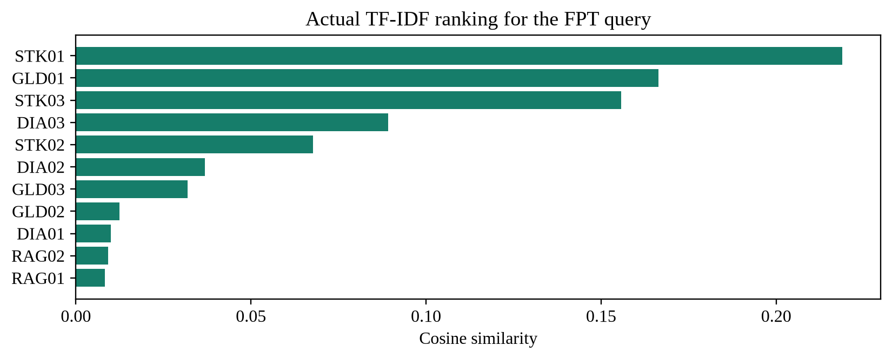

Thứ hạng TF-IDF thực tế cho câu hỏi FPT trên toàn corpus

Năm tài liệu đứng đầu của ví dụ truy xuất

| Hạng | Tài liệu | Miền | Cosine |
| --- | --- | --- | --- |
| 1 | STK01 | stock | 0.218913 |
| 2 | GLD01 | gold | 0.166334 |
| 3 | STK03 | stock | 0.155685 |
| 4 | DIA03 | diabetes | 0.089192 |
| 5 | STK02 | stock | 0.067704 |

Kết quả này cũng bộc lộ một lỗi truy xuất: GLD01 thuộc miền vàng đứng thứ hai vì có nhiều từ chỉ dữ liệu thị trường gần với câu hỏi, trong khi STK02 chứa thông tin chỉ báo FPT chỉ đứng thứ năm. Top-3 vì vậy chưa cung cấp đủ bằng chứng cho phần RSI. Nếu chỉ ghép ba đoạn đầu, câu trả lời không được tự bù một giá trị RSI. Lọc theo thực thể/miền hoặc tách câu hỏi thành hai nhu cầu truy xuất là hướng sửa cần kiểm tra trên tập câu hỏi riêng, không được coi là cải thiện đã đo trong lần chạy này.

Corpus thực nghiệm có 11 tài liệu và 508 đặc trưng TF-IDF unigram/bigram. Query được transform bằng cùng vocabulary đã fit trên corpus rồi tính cosine với từng dòng ma trận. Top-3 chỉ là một ngân sách truy xuất; tài liệu thứ tư không trở thành sai về nội dung chỉ vì bị cắt khỏi ngữ cảnh. Các điểm trong hình là kết quả tính thật, không phải xác suất tài liệu đúng hoặc mức tin cậy của câu trả lời.

Bằng chứng STK01: Chuỗi FPT.VN gồm 1304 phiên từ 15/10/2021 đến 14/10/2026; giá đóng cửa gần nhất 57,100 VND.

Bằng chứng GLD01: Chuỗi vàng GC=F gồm 1257 phiên từ 15/10/2021 đến 14/10/2026; giá gần nhất 4,107.90 USD/oz.

Bằng chứng STK03: Đường trung bình động mô tả xu hướng quá khứ chứ không bảo đảm giá tương lai. RSI là chỉ báo động lượng và cần kết hợp thanh khoản, cơ bản doanh nghiệp cùng bối cảnh thị trường.

Nhánh đồ thị nhận diện miền và lấy các bộ ba liên quan để bổ sung quan hệ giữa mã tài sản, chỉ báo và yếu tố tác động. NetworkX lưu đỉnh/cạnh trong bộ nhớ; không có bước suy diễn tất cả đường đi hoặc xếp hạng cộng đồng đồ thị quy mô lớn. Generator hiện ghép văn bản theo cấu trúc xác định. Do đó cách gọi GraphRAG trong prototype chỉ mô tả việc bổ sung bằng chứng đồ thị, không đồng nhất với một hệ thống GraphRAG dùng LLM để trích xuất và tổng hợp cộng đồng.

Trong CSV bộ ba thật, FPT.VN nối với “Giá FPT 57,100 VND” qua quan hệ CÓ_GIÁ_GẦN_NHẤT; RSI14 nối tới FPT.VN qua ĐO_ĐỘNG_LƯỢNG_CỦA. Cạnh thứ hai chỉ xác định RSI14 đo động lượng của FPT, không chứa giá trị RSI số. Vì thế nhánh đồ thị có thể bổ sung quan hệ nhưng chưa đủ thay tài liệu STK02 bị bỏ khỏi top-3. Cần phân biệt bằng chứng về một quan hệ với bằng chứng về một thuộc tính định lượng tại một thời điểm.

#### 5.8.6. Hai luồng hỏi đáp và giới hạn của câu trả lời

Notebook truy xuất trên corpus đa miền ngắn, trong đó một phần tài liệu thị trường được tạo từ snapshot đã xử lý. Chatbot trên web lại là luồng sức khỏe có corpus riêng, BM25, thực thể và trạng thái đối thoại. Hai luồng dùng chung ý tưởng tìm bằng chứng trước khi trả lời nhưng không dùng cùng chỉ mục, cùng số tài liệu hoặc cùng điểm đánh giá. Không lấy Precision@3 của notebook làm độ chính xác cho chatbot web.

Trong web, câu hỏi được chuẩn hóa để tìm chủ đề; lịch sử đối thoại giữ ngữ cảnh khi cần hỏi thêm đơn vị hoặc mục đích. Luật kiểm tra đơn vị chạy trước các nhánh cần diễn giải chỉ số. Khi tìm được chủ đề, phần trả lời đưa thông tin tham khảo, yếu tố liên quan và cảnh báo phạm vi. Khi thiếu dữ liệu hoặc câu hỏi vượt khả năng, hệ thống phải nêu thiếu thông tin thay vì tạo một kết luận chắc chắn.

Tình huống kiểm tra có thể bắt đầu bằng câu hỏi về HbA1c, sau đó hỏi tiếp về một chỉ số glucose chưa có đơn vị để quan sát yêu cầu làm rõ. Đây là kịch bản tương tác, không phải một hồ sơ bệnh nhân hoặc bằng chứng về năng lực chẩn đoán. Nội dung sức khỏe được giới hạn ở giáo dục và giải thích giao diện; không dùng dự đoán của classifier tổng hợp để thay lời khuyên chuyên môn.

[Demo hỏi đáp](https://rag-httm-chatbot.vercel.app/#chatbot)

#### 5.8.7. Phân biệt ba miền dự đoán gốc và các mô hình bổ sung

Khu dự đoán gốc có ba miền: hồi quy tiến triển bệnh trên bộ diabetes 442 mẫu, dự báo FPT và dự báo vàng với đặc trưng thị trường. Hồi quy y tế trả một thang tiến triển bệnh của dataset, không phải nhãn High/Low/Moderate của 50.000 mẫu tổng hợp ở Chương 2. Hai mô hình thị trường gốc sử dụng đặc trưng được dựng từ lịch sử, trong khi Chương 4 sử dụng 30 log-return và checkpoint recurrent riêng. Giao diện giữ cả hai để đối chiếu phương pháp, không hợp nhất kết quả của chúng thành cùng một phép thử.

Để dùng khu gốc, chọn miền, kiểm tra nhãn và đơn vị từng trường rồi chạy dự đoán. Các giá trị mặc định của thị trường dựa trên snapshot đi kèm cấu hình. Nếu sửa đặc trưng thủ công, người dùng đang tạo kịch bản; không được hiểu đầu ra là cập nhật giá thời gian thực. Phần KG bổ trợ cách đọc yếu tố và quan hệ; nó không tự sửa sai số của regressor hoặc tạo chứng cứ cho một dự báo chưa có nhãn thực.

[Demo ba miền gốc](https://rag-httm-chatbot.vercel.app/#predict)

#### 5.8.8. Đường triển khai, kiểm thử và khả năng tái lập

Mô hình mới được huấn luyện trong notebook, lưu checkpoint và xuất tham số sang JSON nén. Vercel nạp bundle để chạy suy luận bằng Python standard library, không train lại theo yêu cầu người dùng. Rừng cây giữ ngưỡng và lá; CNN giữ kernel/dense; recurrent giữ trọng số cổng và tham số scale. Các tham số tiền xử lý được xuất cùng mô hình để tránh dùng một phép biến đổi khác giữa notebook và web.

Đối chiếu suy luận không chỉ kiểm tra nhãn cuối: 30 vector bảng so sánh giá hoặc điểm theo lớp, sáu ảnh so sánh toàn bộ logits, sáu checkpoint recurrent so sánh giá dự đoán. Sai lệch số thực được kiểm tra với ngưỡng nhỏ trong test tự động. Trường hợp float32 của cây và thứ tự cổng GRU được xử lý theo đúng thư viện train; đây là những chi tiết có thể gây sai kết quả dù giao diện vẫn hoạt động bình thường.

Kiểm thử âm gồm ảnh trống, sai số pixel, NaN/Infinity, giá trị số sai kiểu, chuỗi thiếu phần tử và miền không tồn tại. Kiểm thử trình duyệt xác nhận thao tác chọn ảnh, chạy API, đổi miền và trạng thái lỗi. Các kiểm tra này chứng minh đường xử lý thực thi đúng các trường hợp đã thử, không thay thế đánh giá thống kê ngoài mẫu. Mọi lần thay đổi trọng số hoặc preprocessing cần xuất bundle và chạy lại đối chiếu.

Mỗi biểu đồ phân tích mới có danh sách tệp đầu vào và SHA-256 trong figure_lineage.json. Các CSV prediction, lịch sử train và phép chia được giữ để tính lại bảng kết quả. Các sơ đồ có nhãn minh họa cơ chế chỉ giải thích luồng tính toán; chúng không được xem là ảnh dữ liệu thu thập. Cách tổ chức này cho phép kiểm tra báo cáo từ kết quả số trở về mã và dữ liệu thay vì chỉ dựa vào mô tả bằng lời.

[Web](https://rag-httm-chatbot.vercel.app/)

[GitHub](https://github.com/jellalaz/HTTM_ThayQue)

## 6. Tệp bằng chứng và cách kiểm tra

Điểm bắt đầu để tái lập hoặc kiểm tra một kết luận

| Loại | Tệp / thư mục |
| --- | --- |
| Mã thực nghiệm | src/experiments03.py; nhúng trong main.ipynb |
| Phân tích bổ sung | src/analysis03.py; nhúng trong main.ipynb |
| Chia dữ liệu | artifacts_tl03/data/*_split.csv |
| Dự đoán | artifacts_tl03/data/*_predictions.csv |
| Đường học | artifacts_tl03/data/*_history.csv |
| Nguồn từng hình mới | artifacts_tl03/data/figure_lineage.json |
| Phân tích tổng hợp | artifacts_tl03/data/extended_analysis.json |
| Đối chiếu export | tests/test_inference03.py |
| Chức năng cũ | tests/engine.test.cjs; tests/clinical.test.cjs |
| Production HTTP | tests/check_production03.py; production_verified.json |

Chạy `python tests/test_inference03.py`, `node tests/engine.test.cjs`, `node tests/clinical.test.cjs` sau khi build. Kiểm tra production dùng mẫu công khai/tổng hợp, không dùng dữ liệu riêng của người dùng. Độ đúng phần mềm, hiệu năng thống kê và tính phù hợp cho y tế/tài chính là ba phạm vi khác nhau; test phần mềm không phải chứng nhận chuyên môn. Chưa có kiểm chứng GPU, nhiều seed, dữ liệu lâm sàng bên ngoài hoặc benchmark độc lập chất lượng câu trả lời.
